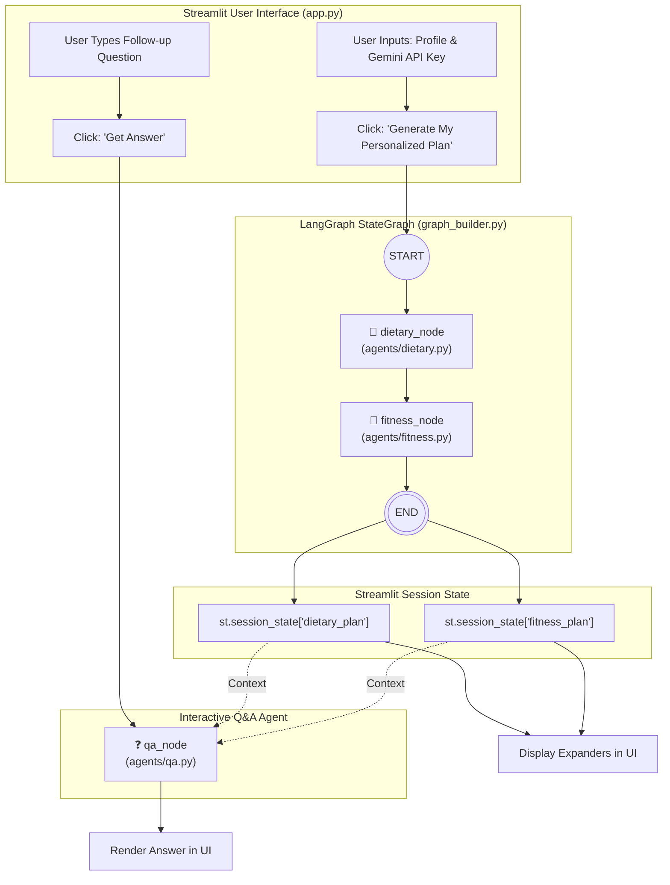

# 🏋️‍♂️ AI Health & Fitness Planner


An intelligent, multi-agent health and fitness planning application built with **Streamlit**, **LangGraph**, and **Google Gemini (`langchain-google-genai`)**. 

The application collects individual biometric data, lifestyle preferences, and fitness targets to autonomously orchestrate tailored dietary and workout regimes, followed by an interactive, context-grounded Q&A assistant to clarify plan details.

---

## 📑 Table of Contents

- [Project Overview](#-project-overview)
- [Key Features](#-key-features)
- [System Architecture](#-system-architecture)
  - [Workflow Diagram](#workflow-diagram)
  - [LangGraph State Schema](#langgraph-state-schema)
  - [Agent Breakdown](#agent-breakdown)
- [Repository Structure](#-repository-structure)
- [Tech Stack](#-tech-stack)
- [Prerequisites](#-prerequisites)
- [Installation & Quickstart](#-installation--quickstart)
- [Configuration](#-configuration)
- [Application Walkthrough](#-application-walkthrough)
- [Troubleshooting & FAQs](#-troubleshooting--faqs)
- [Future Roadmap](#-future-roadmap)
- [License](#-license)

---

## 💡 Project Overview

Traditional fitness applications often offer generic, cookie-cutter templates that fail to account for personal nuances such as metabolic rates, dietary restrictions, or individual fitness milestones. 

**AI Health & Fitness Planner** solves this by leveraging an agentic workflow:
1. It gathers personalized biometric parameters (age, height, weight, biological sex, activity level, dietary preference, and fitness goal).
2. It executes a structured **LangGraph** execution pipeline where specialized agent nodes generate interdependent dietary and fitness recommendations.
3. It retains the generated plans in memory to power a **Context-Aware Q&A Assistant**, enabling users to ask follow-up questions directly grounded in their newly generated plans without hallucination.

---

## ✨ Key Features

- **Personalized Biometric Profiling**: Formulates plans tailored to specific biometric profiles (age, height, weight, sex, activity level).
- **Dietary Agent**: Produces scientific dietary reasoning, structured meal plans (breakfast, lunch, dinner, snacks), and critical nutritional guidance (hydration, electrolytes, fiber).
- **Fitness Agent**: Generates custom workout splits, progressive overload routines, rest schedules, and form safety tips.
- **Context-Aware Q&A Engine**: A dedicated Q&A agent that references the active meal and fitness plans to answer user questions with high precision.
- **Stateful Multi-Agent Orchestration**: Powered by **LangGraph** `StateGraph`, maintaining typed state across the pipeline.
- **Engaging UI Experience**: Built with Streamlit, featuring an intuitive two-column dashboard, collapsible expander cards, and motivational fitness quotes during generation.
- **Secure API Key Handling**: Accepts user-supplied Google Gemini API keys via a password-masked sidebar input.

---

## 🏗️ System Architecture

### Workflow Diagram

The application leverages a **LangGraph** directed graph for synchronous plan generation, followed by ad-hoc execution for the interactive Q&A assistant:



### LangGraph State Schema

The workflow state is typed using Python's `typing.TypedDict` in [graph_builder.py] :

```python
class PlanState(TypedDict, total=False):
    user_profile: str      # Formatted string of user attributes
    dietary_plan: Dict     # Output dictionary from dietary_node
    fitness_plan: Dict     # Output dictionary from fitness_node
    query: str             # User follow-up question for Q&A
    answer: str            # Output generated by qa_node
    api_key: str           # Google Gemini API key
```

### Agent Breakdown

| Agent / Node | Module | Role & Description | Output Payload |
| :--- | :--- | :--- | :--- |
| **Dietary Agent** | [`agents/dietary.py`] | Acts as a clinical nutritionist. Evaluates the user profile and crafts meal structures aligned with calorie and macronutrient targets. | `why_this_plan_works`, `meal_plan`, `important_considerations` |
| **Fitness Agent** | [`agents/fitness.py`] | Acts as a personal trainer. Designs targeted workout routines, exercise breakdowns, rest intervals, and recovery protocols. | `goals`, `routine`, `tips` |
| **Q&A Agent** | [`agents/qa.py`] | Grounds itself strictly in the generated `meal_plan` and `routine` to answer specific user queries (e.g., food substitutions, workout adjustments). | `answer` |

---

## 📁 Repository Structure

```
AI-Health-Planner-using-Langgraph-main/
│
├── agents/                     # Specialized agent modules
│   ├── __init__.py             # Package initializer
│   ├── dietary.py              # Dietary plan agent node
│   ├── fitness.py              # Fitness plan agent node
│   └── qa.py                   # Context-grounded Q&A agent node
│
├── utils/                      # Helper utilities and display components
│   ├── __init__.py             # Package initializer
│   └── helper.py               # Gemini LLM invocation & Streamlit card renderers
│
├── app.py                      # Main Streamlit web application & UI logic
├── config.py                   # Global configuration (model name, loading quotes)
├── graph_builder.py            # LangGraph StateGraph definition & compilation
├── requirements.txt            # Python package dependencies
└── ReadMe.md                   # Comprehensive project documentation
```

---

## 🛠️ Tech Stack

- **Core Language**: Python 3.10+
- **Agent Orchestration**: [LangGraph](https://github.com/langchain-ai/langgraph)
- **LLM Integration**: [LangChain Google GenAI](https://python.langchain.com/docs/integrations/chat/google_generative_ai/) (`ChatGoogleGenerativeAI`)
- **Underlying LLM**: Google Gemini (configured to `gemini-3.8-flash` in [config.py](file:///e:/Q%20Spider/gen%20ai/projects/AI-Health-Planner-using-Langgraph-main/config.py))
- **Web Frontend**: [Streamlit](https://streamlit.io/)
- **Data Validation & Typing**: `typing.TypedDict`

---

## 📋 Prerequisites

Before setting up the project locally, make sure you have:
1. **Python 3.10** or higher installed.
2. A valid **Google Gemini API Key** from [Google AI Studio](https://aistudio.google.com/apikey).

---

## 🚀 Installation & Quickstart

### 1. Clone the Repository

```bash
git clone https://github.com//AI-Health-Planner-using-Langgraph.git
cd AI-Health-Planner-using-Langgraph
```

### 2. Set Up a Virtual Environment

**On Windows (PowerShell):**
```powershell
python -m venv venv
.\venv\Scripts\Activate.ps1
```

**On Windows (Command Prompt):**
```cmd
python -m venv venv
.\venv\Scripts\activate.bat
```

**On macOS / Linux:**
```bash
python3 -m venv venv
source venv/bin/activate
```

### 3. Install Dependencies

Install the required packages from [requirements.txt] :

```bash
pip install -r requirements.txt
```

### 4. Run the Streamlit Application

Launch the Streamlit app:

```bash
streamlit run app.py
```

After running the command, open your browser and navigate to the local URL (usually `http://localhost:8501`).

---

## ⚙️ Configuration

Application settings are managed in [config.py] :

```python
# Motivational quotes displayed in the loading spinner
QUOTES = [
    "💪 Small steps lead to big changes!",
    "🥦 Nourish your body, fuel your mind.",
    "🚴 Consistency beats intensity.",
    "🌟 Believe in yourself and all that you are.",
    "🏃‍♂️ One step at a time, one day at a time."
]

# Model identifier for Google Gemini
LLM_MODEL = "gemini-3.8-flash"
```

> **Note:** If you wish to use a different Gemini model (such as `gemini-1.5-flash` or `gemini-1.5-pro`), update the `LLM_MODEL` variable in [config.py].

---

## 🖥️ Application Walkthrough

1. **Authentication**: Enter your Gemini API key in the left sidebar. The app requires an API key before showing the input form.
2. **Profile Inputs**:
   - **Age**: 10 to 100 years.
   - **Height**: 100.0 to 250.0 cm.
   - **Weight**: 20.0 to 300.0 kg.
   - **Sex**: `Male`, `Female`, `Other`.
   - **Activity Level**: `Sedentary`, `Lightly Active`, `Moderately Active`, `Very Active`, `Extremely Active`.
   - **Dietary Preferences**: `Vegetarian`, `Keto`, `Gluten Free`, `Low Carb`, `Dairy Free`, `Non Vegetarian`.
   - **Fitness Goals**: `Lose Weight`, `Gain Muscle`, `Endurance`, `Stay Fit`, `Strength Training`.
3. **Plan Generation**: Click **🎯 Generate My Personalized Plan**. The LangGraph pipeline executes, invoking the dietary and fitness agents.
4. **Interactive Review**: Expand the generated sections:
   - 📋 **Dietary Plan**: *Why this plan works*, *Meal Plan*, *Important Considerations*.
   - 💪 **Fitness Plan**: *Goals*, *Exercise Routine*, *Pro Tips*.
5. **Ask Follow-up Questions**: Use the Q&A section at the bottom to clarify details (e.g., *"What can I replace eggs with?"* or *"Can I do this workout without gym equipment?"*).

---

## 🔧 Troubleshooting & FAQs

### 1. `GoogleGenerativeAIError` or `403 / 400 API key not valid`
- Ensure you have pasted a valid Gemini API key from [Google AI Studio](https://aistudio.google.com/apikey).
- Make sure there are no accidental spaces before or after the key when pasting it into the sidebar.

### 2. `429 Resource Exhausted / Quota Exceeded`
- The free tier of Google Gemini has rate limits per minute. Wait a few moments before requesting another plan or switch to an API key with available quota.

### 3. `ModuleNotFoundError: No module named 'langgraph'` or `'streamlit'`
- Ensure your virtual environment is active (`venv\Scripts\activate` on Windows or `source venv/bin/activate` on macOS/Linux) before running `streamlit run app.py`.
- Run `pip install -r requirements.txt` to verify all packages are installed.

---

## 🔮 Future Roadmap

- [ ] **Export to PDF / Markdown**: Allow users to download their complete diet and workout regimen.
- [ ] **Persistent Memory & Checkpointing**: Use LangGraph checkpointers (`SqliteSaver` / `PostgresSaver`) to save user sessions across restarts.
- [ ] **Caloric & Macro Calculation**: Integrate automated BMR (Basal Metabolic Rate) and TDEE (Total Daily Energy Expenditure) calculation tools.
- [ ] **Multimodal Capabilities**: Allow users to upload photos of meals or gym equipment to receive real-time feedback.